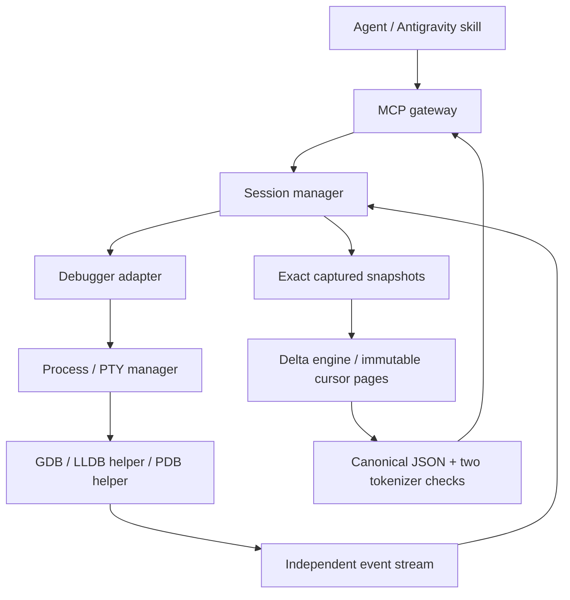

# DEA architecture

Status: foundation contracts implemented; runtime, state engine, sessions and debugger integrations are implementation scaffolds.

## Components and data flow



Adapters depend on contracts and injected services. They do not import other adapters. Runtime does not understand debugger syntax. Sessions arbitrate operations but do not parse debugger protocols. State owns history, identity comparisons, memory differences, and packing. Gateways validate requests, invoke sessions, and enforce the final output boundary.

`bootstrap.py` is the sole composition root. Its factories and constructor signatures are frozen for the eight workers. Tests use the same injection boundaries with fake clocks, processes, adapters, and session services.

## ADR 001: Python contracts and isolated debugger helpers

Use Python 3.12+, Pydantic v2, and the official MCP Python SDK. Their tested foundation versions are pinned in `pyproject.toml`. The current SDK uses `MCPServer`; do not replace it with assumptions about legacy `FastMCP` imports.

GDB uses its machine interface. LLDB runs in a separate helper compatible with its Python bindings rather than importing its ABI into the MCP server. PDB uses a structured `pdb.Pdb` helper. This adds helper framing but avoids coupling the server interpreter to native debugger bindings or human prompts.

Skills invoke MCP tools in the same persistent server. CLI processes provide startup and diagnostics, without a second daemon or independent session store.

## ADR 002: Control and target I/O are separate

GDB MI command results are correlated by request tokens; asynchronous notifications update execution state independently. A command acknowledgement is not a stop. LLDB uses asynchronous process events; PDB uses structured stop callbacks. Do not parse prompt strings to infer state.

Helpers use a dedicated framed local connection. Target output and debugger diagnostics cannot enter that connection. Default target I/O is captured; explicit PTY requests are capability-gated. A platform lacking a safe separate target terminal reports `CAPABILITY_UNAVAILABLE` for PTY requests.

Runtime uses asyncio subprocess pipes and nonblocking PTYs on POSIX. Native Windows uses hidden processes, Job Objects, and synchronous native pipe/ConPTY workers bridged to asyncio by bounded queues. Blocking native reads/writes and process waits never run on the event-loop thread.

## ADR 003: Session lifecycle and ownership

```text
NEW -> STARTING -> STOPPED <-> RUNNING -> TERMINATING -> TERMINATED
                       failures -> FAILED -> cleanup
```

Launch/attach is ownership metadata. An execution operation records whether it is continuing or stepping; neither operation predicts its eventual stop reason. Each session has its own command arbiter and event journal. Subscribe before execution, and handle stop-before-ack, exit-before-ack, and unsolicited events.

Inspection requires STOPPED. Only one execution operation may be outstanding. Interrupt and terminate have priority and cannot wait behind a lock held until a stop. Stop capture must complete, or be explicitly marked partial, before the target is resumed. An exit during capture produces the terminal event, not a fabricated complete snapshot.

Owned POSIX groups and Windows jobs contain launched helpers/debuggers and their launched targets. Windows creates suspended processes, assigns containment, then resumes. Attached targets never enter DEA's owned group/job. Disable debugger kill-on-exit behavior for attached targets wherever the debugger supports it; test normal detach explicitly.

Shutdown requests debugger-native quit/termination or detach first, drains channels, cancels native I/O, closes handles, joins workers, and reaps owned processes. Escalation applies only to owned processes. A detach failure is observable; abnormal debugger failure cannot be described as a successful detach. Close operations are idempotent and cancellation-safe.

Command timeout invalidates pending correlations. Interrupt and resynchronize before accepting subsequent mutations; if recovery cannot establish a stopped state, fail the session and clean up. A `session_wait` timeout only stops waiting.

## ADR 004: Exact history, bounded presentation

Retain original observations independently of compact stops. Compare full values and capture coverage before rendering. Unavailable or uncaptured values do not imply deletion. Stable identities include thread and frame context; reset baselines when contexts cannot be compared.

The initial observation is an addition from an unknown baseline. A compact response references the prior captured stop ID, even when some details were omitted from its presentation. The event journal lets clients retrieve every retained stop in order; event IDs and stop IDs are distinct sequences.

Packing preserves mandatory metadata before optional watched-variable, variable, register, and frame details. Remove whole optional items, update omission metadata, and measure the final wire JSON again. Large values become stored references with distinct identities, preserving changes that share a display prefix.

Cursors reference immutable captured detail strings. Paging never re-evaluates expressions or rereads running targets. Eviction and expiration invalidate dependent cursors explicitly. Memory comparisons cover only configured regions captured at both stops; this is snapshot comparison, not execution replay.

## ADR 005: One measured output boundary

The wire limit is 191 tokens under both pinned encodings. A strict Pydantic model validates shape and semantics; `WireGuard` additionally validates the final canonical serialization. JSON Schema cannot enforce tokenizer-dependent length, so the exported schema declares an `x-token-budget` extension and the server enforces it.

MCP results use one text block and no `structuredContent`. The gateway caps handler errors and SDK input validation errors. Invalid or oversized output becomes a fixed prevalidated error. Missing tokenizer data prevents startup instead of enabling estimates. Tokenizer cache provisioning may require network access during first installation; offline deployments prewarm the same pinned encodings.

The eight-step pacing hint is budgeted with the result. Breakpoint/watchpoint stops or exact watched-value divergence reset the counter; instruction-pointer changes and unrelated register changes do not.

## Verification and release claims

Foundation tests exercise contracts, serialization, MCP wrapping, and scripted events. They do not establish native debugger support. Runtime and adapter workers add their own tests. Release claims for each debugger/platform/capability require passing actual integration scenarios, including process cleanup and attach/detach where applicable.

